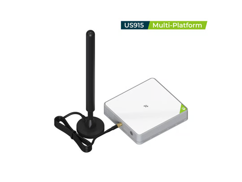

# MeshCore repeater & observer for the SenseCAP M2

Firmware that turns a **Seeed SenseCAP M2 Multi-Platform** LoRaWAN gateway into a **[MeshCore](https://meshcore.io)** device. It's a custom [OpenWrt](https://openwrt.org) 24.10 image running [openHop Repeater](https://github.com/openhop-dev/openhop_repeater), and it supports the US/Canada **62.5 kHz** preset, which the M2's SX1302 gateway chip can't do on its own ([how](docs/radio.md)).

> This is early but I have it running on real hardware. Please report what you find, especially other hardware.

## What you get

* **Repeater** - A MeshCore repeater, up to 27 dBm through the M2's amplifier and external antenna, managed through the MeshCore app or the openHop dashboard, running on port 8000.
* **Observer** - Optionally uploads what it hears via MQTT to MeshMapper, etc.
* **Companion** - An optional second MeshCore identity, so you can use MeshCore directly from the M2.

There are two web pages on the M2:

- **the openHop dashboard**, `http://<address>:8000`, for everything MeshCore
- **the OpenWrt web interface**, `http://<address>`, for Wi-Fi, passwords and firmware updates

## Install

You need a **SenseCAP M2 Multi-Platform** (that's all I've tested it on). Probably goes easier if connected to your network by Ethernet (wi-fi works fine after flashing).

> **Two flashes required.** You install Seeed's open-source firmware first, then this image.
>
> ⚠️ Once Seeed's open-source firmware is added, the factory SenseCAP firmware can't be reinstalled through the web interface.

1. **Log in to your M2.** Find it in your router's device list (it shows up as "SenseCAP"), open `https://<address>`, and log in with the username and password from the sticker underneath.
2. **Flash Seeed's open-source firmware.** Download the file for your region from [Seeed's releases](https://github.com/Seeed-Solution/LoRa_Gateway_OpenWRT/releases), e.g. the one ending `-sysupgrade-US915-4G.bin` (the 4G build works fine without a cellular modem). Go to **System → Backup / Flash Firmware → Local upgrade** and flash it. Untick *Keep settings* if offered. You can skip this step if you're already running ChirpStack Gateway OS.
3. **[Download this firmware](https://github.com/andyfowler/meshcore-sensecap-m2/releases/latest)**. Choose the file ending `-squashfs-sysupgrade.bin`, or `-waev-squashfs-sysupgrade.bin` for the version that also includes the [waev:outpost](#waevoutpost-console) console.
4. **Flash this firmware.** Open the OpenWrt web interface at `http://<address>` (user `root`, no password). Go to **System → Backup / Flash Firmware → Flash new firmware image**, untick *Keep settings*, and flash.
5. **Wait about 5 minutes.** The first boot is slow.

## Set up openHop

Open the openHop dashboard at `http://meshcore-m2-xxxxxx.local:8000` (`xxxxxx` is the end of the M2's MAC address) or `http://<ip>:8000`. The setup wizard asks for:

- **Name** for the repeater
- **Connection type**: choose **SenseCAP M2 / other GPIO device**
- **Hardware**: choose **SenseCAP M2 (built-in radio)**
- **Radio preset** your mesh uses (US/Canada: 910.525 MHz, 62.5 kHz, SF7, CR 4/5)
- **Admin password**, 8 or more characters, for the dashboard and MeshCore remote admin. This password will also become your OpenWRT root password.

Then it starts repeating. Change anything else (location, transmit power, regions, path hash mode, delays, owner info) in the openHop dashboard or with the usual repeater commands in the MeshCore app. Settings survive reboots and updates.

### Wi-Fi

The M2 can use Wi-Fi (2.4 GHz only) instead of Ethernet:

1. In the OpenWrt web interface, go to **Network → Wireless** and click **Scan**.
2. Click **Join Network** next to your network.
3. Enter your Wi-Fi password, leave the network name as `wwan`, and set **Create / Assign firewall-zone** to **`wan`**. The `wan` zone is what lets you reach the M2 from your network.
4. Click **Submit**, then **Save**, then **Save & Apply**.

The M2 gets a new IP address on Wi-Fi. Once you can reach the openHop dashboard at that address, you can unplug the Ethernet cable.

### Community settings files

Your local mesh group may publish a settings file with its recommended values. After the wizard, import it under **Configuration → Backup & Restore → Import Configuration** in the dashboard.

Regions aren't part of the file; set them with `region put …` commands. A file's broker list replaces your current one, so it should list every network you want to upload to.

### Passwords and keys

- The repeater's **identity key** is generated on the M2. Back it up (or import an existing one) in the dashboard.
- The **root** password (SSH and the OpenWrt web interface) is set to your admin password when the wizard finishes. SSH password logins are off until then.

### waev:outpost console

The `-waev` image also includes [waev:outpost](https://github.com/Treehouse-00/waev-outpost-plugin), an alternative console for openHop with a mesh map, a packet inspector and companion chat. Open it at `http://<address>:8000/plugins/waev.outpost/` and log in with your dashboard password. To make it the page at `http://<address>:8000/`, go to **System → Configuration → Access → Web Options → Web Frontend** in the openHop dashboard.

- It's trimmed to fit the M2's flash: no animated login screen.
- A few features, like Path Trace, need a newer openHop than the one in this image.
- It updates with this firmware, not with its own update button.
- It leaves about 8 MB of flash for settings instead of about 12 MB.

### Memory

The M2 has 128 MB of RAM. The repeater, dashboard and one companion fit comfortably. OpenHop plugins may not.

## Updating

You can't use openHop's built-in upgrade system. openHop is built into the firmware, so update with firmware releases, not the dashboard's update button. (Maybe we can fix this).

Download the new `-squashfs-sysupgrade.bin` (or `-waev-squashfs-sysupgrade.bin`) from [releases](../../releases) and flash it in the OpenWrt web interface (**System → Backup / Flash Firmware**) with *Keep settings* **ticked**.

Your keys, settings, etc. are kept.

## Help

- **Logs**: `ssh root@<address>`, then `logread -e m2modem` for the radio or `logread | grep python3` for openHop. Also in the OpenWrt web interface under **Status → System Log**.
- **Dashboard not loading**: openHop takes 1–2 minutes to start after a reboot.
- **Start over**: `firstboot -y && reboot` wipes all settings and keys. Export your identity first.
- **Recovery**: press the reset button repeatedly while the M2 boots to enter OpenWrt failsafe mode at `192.168.1.1`. The bootloader also has a TFTP recovery menu on the USB-C serial console (57600 baud).

## In this repo

- **`feed/m2modem/`** – the radio driver. A small C daemon that runs the M2's SX1250 radio as a standard LoRa transceiver (including 62.5 kHz), switches the front-end amplifier, and serves openHop's modem protocol on `127.0.0.1:5055`. See [docs/radio.md](docs/radio.md).
- **`feed/openhop-repeater/`** – openHop Repeater and openHop Core packaged for OpenWrt, pinned to tested versions, with the few Python libraries OpenWrt doesn't ship and a small patch that adds the M2 to the setup wizard.
- **`feed/waev-outpost/`** – the waev:outpost console for the `-waev` image, trimmed to fit.
- **`feed/meshcore-m2-base/`** – first-boot setup: optional preset configuration (`/etc/config/meshcore`), root password and SSH handling, and saving openHop's database to flash so regions and companion contacts survive reboots.
- **`target/sensecap-m2/`** – the OpenWrt 24.10 image configuration and M2 device support.
- **`build/`** – Dockerfile and build script. See [docs/building.md](docs/building.md).
- **`.github/workflows/`** – builds the image and attaches it to releases.

### Changes to upstream software

- **openHop**: adds the M2 to the setup wizard; hides the dashboard's "Plugin manager is unavailable" banner; shows this repo's commit as an M2 badge under the version badges; writes the openHop version into the package, so the dashboard doesn't offer an update and the MeshCore app's version query gets a real answer; reports the model as `openHop-Repeater (SenseCAP M2)` in MQTT status messages; replaces pycryptodome with a tiny wrapper around OpenWrt's OpenSSL; bundles dateutil and websockets itself, because OpenWrt's packages for them pull in its whole Python library; ships only compiled Python files; and skips two slow startup steps in CherryPy's dependencies (a timezone table and a package-version lookup).
- **SX1302 HAL**: Seeed's patch for the M2's half-duplex SPI bus.
- **waev:outpost**: drops its login videos, terminal easter eggs and unused background photos (11.5 MB down to 4 MB).
- **OpenWrt**: ChirpStack's M2 device support, with the flash chip clocked at 40 MHz instead of Seeed's 10 MHz, and 64 KB compressed blocks instead of 256 KB. openHop loads hundreds of small files at startup, and both changes make that much faster. Also, Python's `cffi` package without `pycparser`, which it only needs to compile new bindings.

## More

- [docs/radio.md](docs/radio.md): how the M2's radio does 62.5 kHz, and radio troubleshooting
- [docs/building.md](docs/building.md): build the firmware yourself, optionally with your settings built in

## Credits

- William Dillon's [The Unfortunate Unsuitability of using LoRa Gateway Concentrators with MeshCore](https://housedillon.com/blog/meshcore-and-lorawan/) and its comments, which mapped out the problem this project works around
- [openHop Repeater and openHop Core](https://github.com/openhop-dev) – the repeater, dashboard and MeshCore stack
- [Semtech SX1302 HAL](https://github.com/Lora-net/sx1302_hal) – concentrator register access
- [Seeed Studio](https://github.com/Seeed-Solution/LoRa_Gateway_OpenWRT) – the M2's open-source firmware and SPI patch
- [ChirpStack Gateway OS](https://github.com/chirpstack/chirpstack-gateway-os) – M2 device support for OpenWrt 24.10
- [MeshCore](https://github.com/meshcore-dev/MeshCore) and [OpenWrt](https://openwrt.org)
